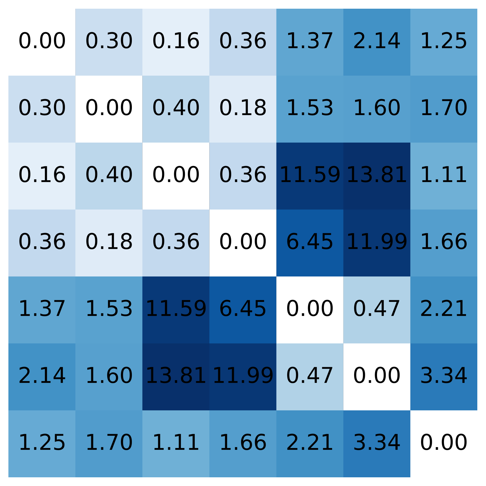
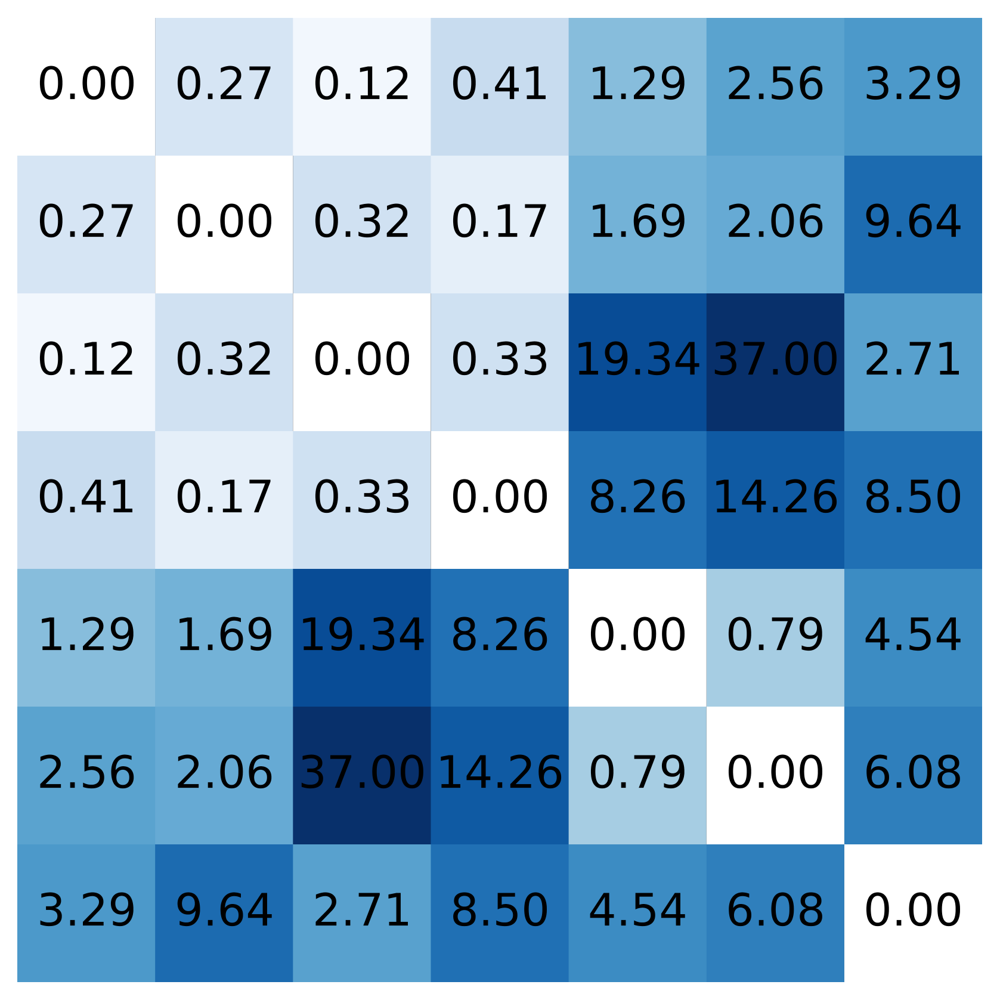
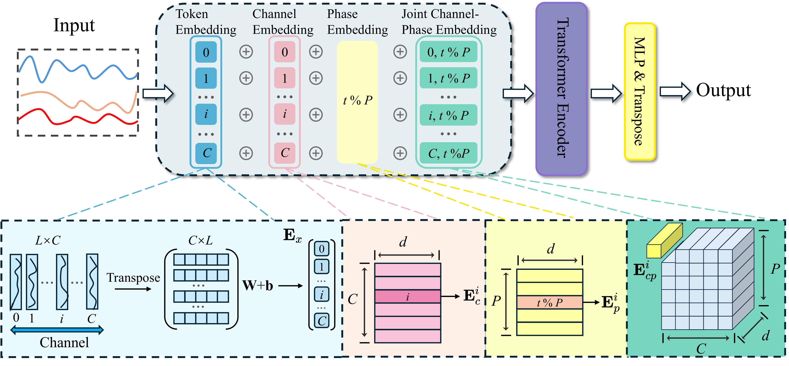
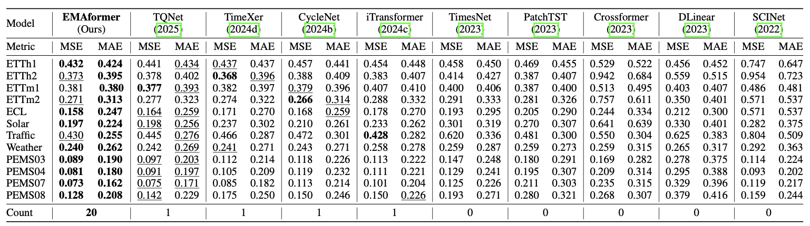
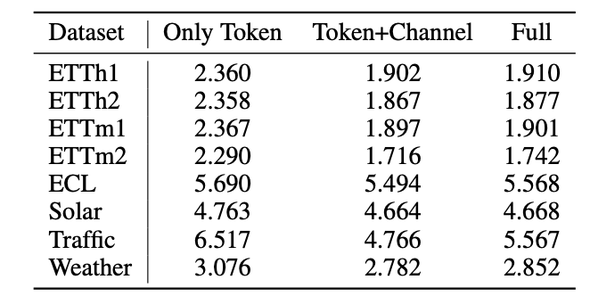
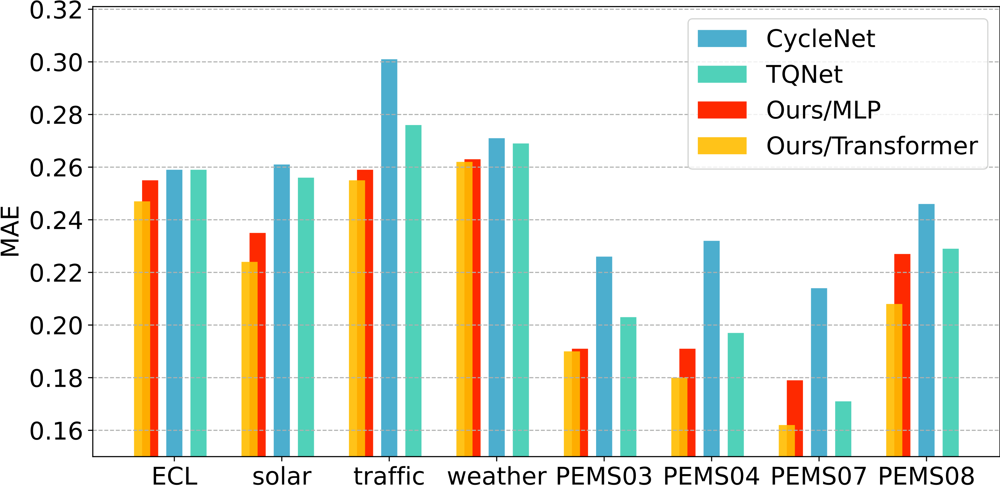

<h1 align="center">
  <br>
  EMAformer
</h1>

<p align="center">
  <em>通过引入额外的嵌入，提升 Transformer 在时间序列预测中的表现。</em>
</p>

<p align="center">
  
  
  <a href="https://arxiv.org/abs/2511.08396">
    
  </a>
</p>

本页根据论文作者的官方实现文档翻译。作者的实验结果和推荐环境见下文，本仓库实际使用的环境、复现步骤和结果可在复现报告中查看。[上游原文](https://github.com/PlanckChang/EMAformer) · [本仓库的复现报告](../复现报告.md)

这项工作研究了为什么显式建模不同变量之间的关系有时会降低预测精度，以及如何改进用于时间序列预测的 Transformer。[论文原文](https://arxiv.org/abs/2511.08396)

## 更新记录

- 2025 年 11 月，EMAformer 论文被 AAAI 2026 接收。

## 方法与论文结果

EMAformer 在 Transformer 中引入额外的嵌入。作者在 12 个真实数据集的基准评测中报告了领先的表现，均方误差（MSE）和平均绝对误差（MAE）平均分别下降了 2.73% 和 5.15%。

<p align="center">
  
  
</p>

作者用变异系数（CoV）衡量变量间相关性相对于其均值的波动。ETTh2 和 ETTm2 的变量间相关性随时间明显变化，变异系数也很高。这说明局部的变量间关系不稳定，可能干扰自注意力对这些关系的建模，降低预测精度。

<p align="center">

</p>

EMAformer 以变量为输入单元，在 Transformer 中加入三种辅助嵌入。变量嵌入提供全局变量表征，用于稳定局部变量间关系。相位嵌入补回时间细节，让模型更好地区分不同周期位置。变量与相位的联合嵌入用于刻画变量和时间之间的复杂依赖。

<p align="center">

</p>

在多变量长期预测中，作者报告了 20 项最优结果和 3 项次优结果。所有实验的历史窗口长度固定为 $L = 96$。PEMS 系列数据集对 12、24、48 和 96 步的预测结果取平均，其余数据集对 96、192、336 和 720 步的预测结果取平均。图中最优值以**粗体**标出，次优值以下划线标出，数值越低越好。

<p align="center">

</p>

从注意力分数的熵变化来看，作者认为这些嵌入保留了周期信息，也让模型对每个变量更关注有助于预测的输入信息。

<p align="center">

</p>

作者把 Transformer 主干换成多层感知机（MLP），并与当时表现最好的 MLP 基线比较。采用相同嵌入设计的 MLP 版本在几乎所有数据集上都优于其他 MLP 基线。

## 作者推荐的运行环境

- Python 3.8
- PyTorch 2.0.0 或更高版本，CUDA 12.0 或更高版本
- 依赖版本见 `requirements.txt`

```bash
git clone https://github.com/PlanckChang/EMAformer.git
cd EMAformer
conda create python=3.8 -n EMAformer
conda activate EMAformer
pip install -r requirements.txt # -i https://pypi.tuna.tsinghua.edu.cn/simple
```

## 代码目录

- `run.py` 是训练和评估的统一入口。
- `model/` 保存 EMAformer 和对照模型。
- `layers/` 保存注意力、嵌入和编码器组件。
- `data_provider/` 保存数据加载器及其调用接口。
- `experiments/` 保存实验执行逻辑。
- `scripts/` 保存各种实验配置可直接运行的 Bash 脚本。
- `utils/` 保存评价指标、时间特征处理和其他辅助工具。

## 准备数据

1. 从作者提供的链接下载数据集。[Google 云端硬盘](https://drive.google.com/file/d/1l51QsKvQPcqILT3DwfjCgx8Dsg2rpjot/view?usp=drive_link) · [百度网盘](https://pan.baidu.com/s/11AWXg1Z6UwjHzmto4hesAA?pwd=9qjr)
2. 将数据集解压到代码根目录下的 `dataset` 文件夹。

## 快速开始

在代码根目录运行下面的命令，启动 ECL 数据集上的多变量预测实验。

```bash
# run the multivariate forecasting experiments with ECL  
bash scripts/multivariate_forecasting/ECL/EMAformer.sh
```

常用命令行参数

- `--seq_len` 和 `--pred_len` 分别指定输入步数和预测步数。
- `--d_model`、`--n_heads`、`--e_layers` 和 `--d_ff` 分别指定模型维度、注意力头数、编码器层数和前馈层的隐藏维度。
- `--cycle` 指定预设的周期长度。
- `--enc_in`、`--dec_in` 和 `--c_out` 分别指定编码器的输入变量数、解码器的输入变量数和模型的输出变量数。在 EMAformer 中，三者取值相同。

## 扩展模型和数据集

- 添加数据集时，在 `data_provider/data_loader.py` 中编写加载器，再在 `data_provider/data_factory.py` 中注册。
- 添加模型时，在 `model/` 下创建对应模块，再在 `experiments/exp_basic.py` 中注册。

## 引用论文

使用此代码开展研究时，可用以下 BibTeX 引用原论文。

```
@article{zhang2025emaformer,
  title={EMAformer: Enhancing Transformer through Embedding Armor for Time Series Forecasting},
  author={Zhang, Zhiwei and Du, Xinyi and Guo, Xuanchi and Wang, Weihao and Han, Wenjuan},
  journal={arXiv preprint arXiv:2511.08396},
  year={2025}
}
```

## 许可证

作者的项目采用 MIT 许可证。[许可证全文](LICENSE)

## 联系作者

如有问题、错误报告、改进建议或代码贡献，可在上游仓库提交议题，也可联系作者 Zhiwei Zhang（zhiweizhang@bjtu.edu.cn）。[上游议题页面](https://github.com/PlanckChang/EMAformer/issues)

## 致谢

- [iTransformer](https://github.com/thuml/iTransformer)
- [CycleNet](https://github.com/ACAT-SCUT/CycleNet)
- EMAformer 标志由 Gemini 提供。[Gemini](https://gemini.google.com/)
